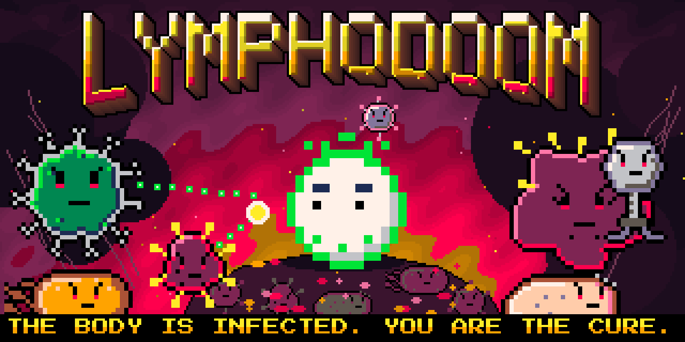

# LYMPHODOOM

Doom (1993) inside the human body. You are a killer T cell. Fight viruses, bacteria, parasites,
phages, spores and tumour cells through three levels: a lymph node, the bloodstream and a tumour
with the TUMOR MASS boss.

The body is infected, and its health (BODY) drains over time: a full body lasts 15 minutes on
COMMON COLD and 9 on METASTASIS. Each enemy killed gives back 1 %, the boss 10 %. Your own cells
wander the rooms; each one killed, by you or by enemy fire, costs the body 5 %. At 0 % the body dies and you start over.

**Play:** https://kostachernyshov.com/lymphodoom/ (desktop, keyboard and mouse).

## What is in this repository

The sources of the whole game. The built engine and game data are not stored:

- **Tracked:** the generators for all art, maps, sound and music (`art/`, `tools/`), the engine
  patch and build script (`engine/`), and the game page (`web/`: HTML, images, `.htaccess`).
- **Not tracked:** `web/game/` (`index.js`, `index.wasm`, `index.data` and `.gz` copies,
  about 1.5 MB gzipped). It is the engine plus the game data, produced by the build below.
  So a fresh clone cannot be played until it is built.

## Build

Built and tested on Linux with Emscripten 4.0.10. The script clones the engine
([Dwasm](https://github.com/GMH-Code/Dwasm)), applies `engine/lymphodoom.patch`, builds a native
engine (for its resource WAD), generates the game WAD, builds the WebAssembly engine and the page.

Debian / Ubuntu:

    sudo apt install git cmake build-essential python3-pil python3-numpy python3-shapely zdbsp \
        libsdl2-dev libsdl2-mixer-dev libsdl2-net-dev libpng-dev libpcre2-dev libfluidsynth-dev libvorbis-dev

    git clone https://github.com/emscripten-core/emsdk.git ~/emsdk
    ~/emsdk/emsdk install 4.0.10 && ~/emsdk/emsdk activate 4.0.10
    . ~/emsdk/emsdk_env.sh

    # only GENMIDI, DMXGUS and a few UI lumps are taken from Freedoom (BSD licence)
    curl -LO https://github.com/freedoom/freedoom/releases/download/v0.13.0/freedoom-0.13.0.zip
    unzip freedoom-0.13.0.zip

    git clone https://github.com/kosta-blackshow/lymphodoom.git && cd lymphodoom
    sh engine/build.sh ../freedoom-0.13.0/freedoom1.wad

macOS (Homebrew; not tested on macOS):

    brew install cmake python sdl2 sdl2_mixer sdl2_net libpng pcre2 fluid-synth libvorbis zdbsp
    pip3 install pillow numpy shapely
    # then emsdk, Freedoom and build.sh as above

The result is `web/game/`. Run it locally:

    python3 -m http.server 8000 -d web

and open http://localhost:8000/. To publish, copy `web/` without `page.template.html` to the
server; `.htaccess` picks the language by domain and serves the `.gz` files.

For page-only changes, the existing `web/game/` engine can be reused:

    python3 art/webart.py web
    python3 tools/page.py

The second command also exports `web/title-score.json` from the same E1M1 composition as the
game's MIDI. `web/title-music.js` plays it with a small chiptune synth while the poster and
difficulty selection are visible; gameplay uses the engine's original instruments. Autoplay
is attempted on opening the page and retried on the poster click if blocked by the browser.
The music button controls the pre-game track. Starting the engine hides that button and stops
the track when gameplay becomes visible. The page keeps the tab title `LYMPHODOOM` even when SDL
sets its own window title.

Checked on 2026-10-17 in headless Chrome: EN/easy and RU/hard both reach the game from the
poster, tab title survives engine startup, pre-game music starts on interaction and stops at
the handoff, and the narrow layout has no horizontal overflow. The WebAssembly engine and WAD
are reused from the existing build; no engine or game-data changes are needed for this release.
GPU performance, listening by ear and hosting configuration still need the owner's check.

## Layout

| Path | What |
| --- | --- |
| `art/` | Sprites, weapons, textures, HUD, screens, page art and the poster, drawn in code |
| `tools/build.py` | Builds `lymphodoom.wad` (the IWAD) and a palette-matched `prboomx.wad` |
| `tools/maps.py`, `tools/mapgen.py` | The three levels (organic rooms and tubes; nodes by zdbsp) |
| `tools/sfx.py`, `tools/music.py` | Sound effects and MIDI music |
| `tools/dehacked.py` | Monster stats and behaviour (DEHACKED/BEX), UMAPINFO |
| `tools/page.py` | Renders `web/index.html` (EN) and `web/ru.html` (RU) from `web/page.template.html` |
| `tools/playtest.py` | Headless play-test of the native engine (Xvfb + xdotool) with screenshots |
| `engine/` | Engine patch, default config, HTML shell, `build.sh` |
| `vendor/pixel_kit/` | Palette, drawing primitives and cast from the Cancer Wars pixel kit |
| `docs/engine-patch.md` | What the engine patch changes, test switches |
| `docs/bible-addendum.md` | Where the game departs from the Cancer Wars character bible |

## Licences

GNU GPL v2 or later (`COPYING`), like the engine (Dwasm, PrBoomX, PrBoom+, Doom source by
id Software). Freedoom lumps: BSD, © Freedoom contributors. Press Start 2P font: SIL OFL.
Not affiliated with id Software, Bethesda or ZeniMax Media.
